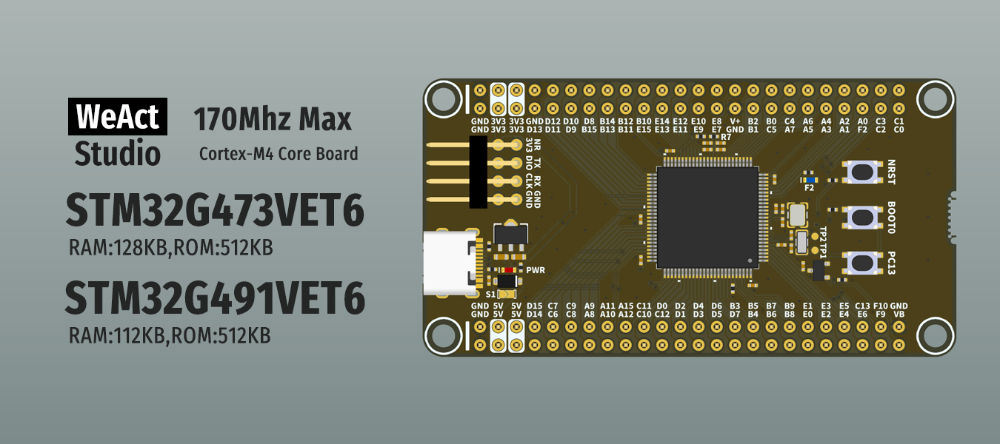

* [中文版本](./README_zh.md)
# WeActStudio.STM32G4_100Pin_CoreBoard

STM32G473VET6
> 170Mhz Max,128KB RAM,512KB ROM

STM32G491VET6
> 170Mhz Max,112KB RAM,512KB ROM

ST Official Website www.st.com

|Dir Name|Explain|
| :--:|:--:|
|Doc|DataSheet/ReferenceManual|
|Hardware|Hardware Development Kit|
|Examples|Software Examples|

```
/*---------------------------------------
- WeAct Studio Official Link
- taobao: weactstudio.taobao.com
- aliexpress: weactstudio.aliexpress.com
- github: github.com/WeActStudio
- gitee: gitee.com/WeActStudio
- blog: blog.weactstudio.com
---------------------------------------*/
```
