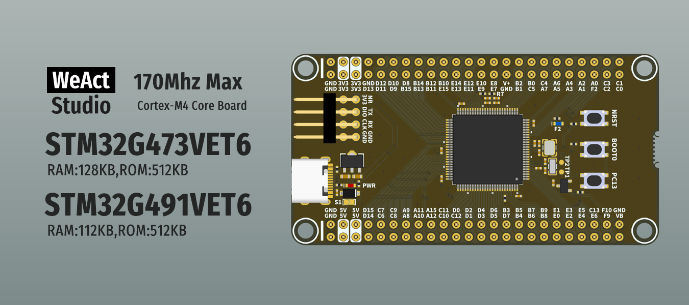

* [English version](./README.md)
# WeActStudio.STM32G4_100Pin_CoreBoard

STM32G473VET6
> 170Mhz Max,128KB RAM,512KB ROM

STM32G491VET6
> 170Mhz Max,112KB RAM,512KB ROM

ST 官方网站 www.st.cn

|目录名称|内容|
| :--:|:--:|
|Doc| 数据手册/参考手册|
|Hardware| 硬件开发资料|
|Examples|软件例程|

```
/*---------------------------------------
- WeAct Studio Official Link
- taobao: weactstudio.taobao.com
- aliexpress: weactstudio.aliexpress.com
- github: github.com/WeActStudio
- gitee: gitee.com/WeActStudio
- blog: blog.weactstudio.com
---------------------------------------*/
```